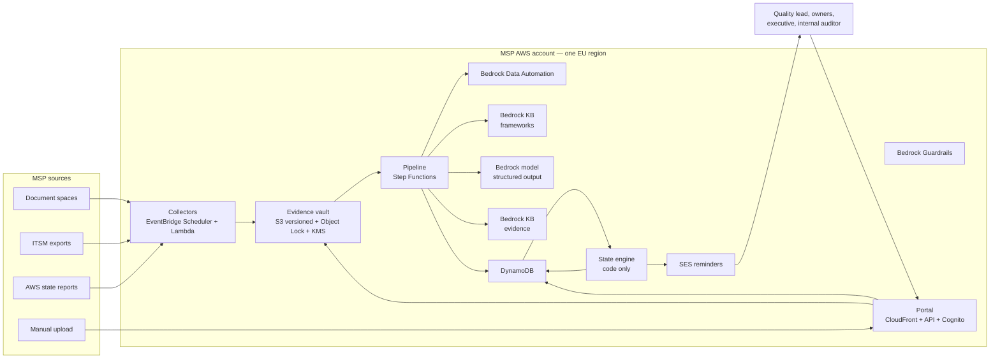

# Registre

**Continuous audit-evidence registry for AWS MSP partners, built on Amazon
Bedrock.** Hackathon AWS MSP AI, Track 1 — *Run Your MSP Better*; submitted for
the **Best Amazon Bedrock Application** prize.

---

## The problem

To be validated in the AWS MSP programme, a partner passes an audit run by an
independent third party. ISO 27001 works the same way. Each time, the team spends
weeks gathering evidence that is scattered across a document store, a ticketing
tool, a spreadsheet of certifications and a handful of inboxes.

Nothing happens for eleven months; then several weeks of panic. A policy last
reviewed two years ago is discovered the day before the auditor arrives. Only one
person knows where anything is. AWS Audit Manager, which automated evidence
collection for AWS resources, is closed to new customers — and an MSP audit is
mostly about organisational documents, which it never covered.

## The promise

Registre does that work all year:

1. **Collects** evidence where it already lives — a document bucket, a manual
   upload, an ITSM export, a dated AWS state report.
2. **Reads** each document with Bedrock Data Automation: type, date, covered
   period, version, author, approver, client, summary, personal data.
3. **Attaches** it to the controls it supports — with the passage that justifies
   each link, verified against the document text by code.
4. **Compares** what the document contains with what the control expects, element
   by element, and lists what is missing.
5. **Watches freshness** and reminds the owner 30 days before expiry, saying
   exactly what to provide.
6. **Assembles** the audit pack on demand: index per control, evidence,
   checksums, known gaps.

On the 60-evidence demonstration set: over 90 % of fields read correctly, over
85 % of attachments accepted without correction, every seeded gap detected, over
90 % of answers with a verified citation, and no invented answer on the five trap
questions.

## What the tool never says

Registre never describes a control as satisfied in the auditor's sense. There is
no such state in the data model — `ControlState` has exactly five values:

| State | Meaning |
|---|---|
| `COVERED` | At least one applied evidence, fresh, and complete against the expected elements |
| `TO_RENEW` | The best evidence expires within 30 days |
| `TO_VERIFY` | Only proposed attachments, or a partial sufficiency |
| `EXPIRED` | Every applied evidence is older than the control's periodicity |
| `NO_EVIDENCE` | No applied evidence at all |

The wording is refused by the domain layer (`src/domain/vocabulary.ts`), checked
in CI (`tools/quality/checkWording.ts`) and tested (acceptance R15). This
document therefore writes "the c-word" when it has to mention the ban — that is
rule ENF-IA-01, and it is the same rule that keeps a green dashboard from ever
standing in for an auditor's judgment.

Doubt always resolves downwards: an uncertain case becomes `TO_VERIFY`, never
`COVERED`; an evidence with no readable date can never make a control `COVERED`;
a complete sufficiency on a mandatory control needs a human validation the first
time that evidence type is seen.

## Architecture



Full diagrams, the component table and the **Bedrock function → usage → why**
table are in [`docs/ARCHITECTURE.md`](docs/ARCHITECTURE.md).

## Quick start (offline, no AWS account)

```bash
npm install && npm run demo
```

That runs the whole product against deterministic mocks and an in-memory store:
it imports the 30-control demonstration framework, ingests the 60 generated
evidences, reads them, proposes attachments, computes sufficiency and control
states, sends the reminders, answers questions, assembles an audit pack — and
prints the readiness table plus the ten seeded situations, each with its expected
outcome. No network call, no credentials, nothing to clean up.

| Command | What it does |
|---|---|
| `npm run demo` | End-to-end offline run (the one command above) |
| `npm run demo:generate` | Regenerate the 60 demonstration evidences into `demo/` |
| `npm run api` | Local HTTP server exposing the sixteen endpoints |
| `npm run eval:local` | Score the four quality measures against their targets |
| `npm test` | Full test suite (`node --test`) |
| `npm run typecheck` | `tsc --noEmit` |
| `npm run check:sizes` | Guard: files < 500 lines, functions < 50 |
| `npm run check:wording` | Guard: no control is ever described with the c-word (ENF-IA-01) |
| `npm run verify` | All four gates in one command |

The portal is a separate app:

```bash
cd portal && npm install && npm run dev
```

It ships with a mock client, so the interface is browsable without a back end.

## Deploy on AWS

Nine CDK stacks, one European region, one account. The full procedure — including
the three one-time manual steps — is [`infra/README.md`](infra/README.md); it is
also acceptance test R16 ("installation in a fresh account").

```bash
export CDK_DEFAULT_ACCOUNT="$(aws sts get-caller-identity --query Account --output text)"
export CDK_DEFAULT_REGION=eu-central-1     # Data Automation needs eu-central-1 or eu-west-1
cd infra && npm install && npm run typecheck && npm run synth && npm run deploy
```

`npm run synth` works offline, without credentials: handlers that do not exist yet
are replaced by a stub answering `501`, with a warning naming the file.

| Stack | What it creates |
|---|---|
| `Registre-Vault` | Versioned S3 bucket with Object Lock (strict retention mode) and a customer-managed KMS key |
| `Registre-Data` | One DynamoDB table (PK/SK, two GSIs, PITR, KMS) |
| `Registre-Bedrock` | Two managed knowledge bases, a guardrail, a Data Automation project, least-privilege roles |
| `Registre-Pipeline` | Step Functions chain and the seven task Lambdas |
| `Registre-Api` | HTTP API, Cognito pool with five role groups, the sixteen endpoints |
| `Registre-Portal` | CloudFront distribution with origin access control |
| `Registre-Notify` | SES identity, daily reminders, weekly digest |
| `Registre-Collectors` | EventBridge Scheduler, three collectors, dead-letter queue |
| `Registre-Observability` | One alarm set per function, dashboard, monthly budget |

## Demonstration credentials

The five judge accounts are created per deployment, never committed:

```bash
cd infra && ./scripts/create-demo-users.sh
```

It prints one login and one generated password per role. Passwords are not stored
in the repository or in a CloudFormation template.

| Login | Role | What to try |
|---|---|---|
| `quality.lead@example.com` | `QUALITY_LEAD` | Readiness, validation queue, pack assembly, settings |
| `control.owner@example.com` | `CONTROL_OWNER` | Only their own controls; deposit evidence, see their reminders |
| `executive@example.com` | `EXECUTIVE` | Readiness and six-month trend, read-only |
| `internal.auditor@example.com` | `INTERNAL_AUDITOR` | Ask questions; restricted evidence is absent from answers |
| `admin@example.com` | `ADMIN` | Sources, access, audit log |

In the offline demo the same five identities exist with fixed passwords printed
on screen.

## How the submission maps to the judging criteria

| Criterion | Where to look |
|---|---|
| **Technical implementation** — Bedrock used deeply | `docs/ARCHITECTURE.md` §4: two managed knowledge bases, Data Automation, structured outputs, Guardrails, evaluation tasks, Flex tier, prompt caching — each with the reason it was chosen; `infra/lib/bedrock-stack.ts` for the resources |
| **Design** — quote verified by code, human validation, integrous evidence, imported framework, prudence written into the state rules | `src/domain/**` (states, freshness, sufficiency, citation, access), `docs/DECISIONS.md` (19 ADRs), `docs/SECURITY.md` |
| **Impact** — a problem every MSP candidate meets, with three measures | `docs/HLD.md` §2, `docs/SUBMISSION.md` §3.3, `docs/EVALUATION.md` |
| **Innovation** — audit preparation becomes continuous monitoring, taking over where a closed AWS service stopped | `docs/SUBMISSION.md` §3.4, `docs/HLD.md` §1 |

Deliverables: [`docs/HLD.md`](docs/HLD.md) (high-level design),
[`docs/ARCHITECTURE.md`](docs/ARCHITECTURE.md) (diagrams),
[`docs/DEMO.md`](docs/DEMO.md) (three-minute script and acceptance walkthrough),
[`docs/SUBMISSION.md`](docs/SUBMISSION.md) (checklist and criteria).

## Repository layout

```
registre/
├── src/
│   ├── domain/        types and rules: states, freshness, sufficiency, citation, access
│   ├── ports/         every boundary as an interface (no implementation)
│   ├── support/       ISO-8601, SHA-256, ids, normalisation, clocks, errors
│   ├── ai/            prompts (with the injection fence), Bedrock adapters, mocks
│   ├── pipeline/      ingest → read → attach → sufficiency → states → pack
│   ├── store/         DynamoDB single table, in-memory store, S3 vault, audit chain
│   ├── collectors/    S3, manual, ITSM, AWS state report
│   ├── notify/        reminder text, digest, SES
│   └── api/           the sixteen endpoints, local server, Lambda handlers
├── portal/            React SPA (Vite): readiness, validation, evidence, ask, packs
├── infra/             AWS CDK: nine stacks, deployment README, demo-user script
├── tools/
│   ├── demo/          demonstration framework, generator, end-to-end run
│   ├── eval/          four datasets, local scorer, Bedrock evaluation payloads
│   └── quality/       size guard and wording guard (CI)
├── demo/              generated demonstration documents
├── eval/              datasets and Bedrock evaluation artefacts
├── test/              node --test suites, one file per unit
├── docs/              English deliverables (HLD, architecture, API, security, …)
├── CONTRACTS.md       engineering contract (conventions, module map, gates)
└── README.md
```

## No protected framework text

**No protected framework text is included in this repository.** Not the AWS MSP
programme validation list (available only to connected partners in AWS Partner
Central), not the ISO 27001 standard text. The 30-control framework used for the
demonstration (`demo-msp`) was written for this submission, and the 60 evidences
are generated documents about a fictional MSP: no customer data, no employee
data, no real console screenshot.

Every partner imports their own framework file (Annex A format); the tool stores
it in their own account, with a confidentiality level. That is what makes the
product reproducible in another partner's environment — and what keeps the
licensing question off the table.

## Security in one paragraph

Role-based access with five roles and three access levels, personal data masked
in excerpts and answers, restricted evidence never cited to a reader without
clearance, encryption at rest with a customer-managed key and TLS in transit,
EU-only hosting validated at deployment time, an immutable versioned vault with
Object Lock, an append-only hash-chained audit log, and a prompt-injection defence
that treats every document as data. Details in
[`docs/SECURITY.md`](docs/SECURITY.md).

## Beyond the hackathon scope

Three extensions and a bonus, built on the same spine — contracts in
[`docs/CONTRACTS-EXT.md`](docs/CONTRACTS-EXT.md), rationale in
[`docs/HLD.md`](docs/HLD.md) §8, decisions ADR-16 to ADR-19 in
[`docs/DECISIONS.md`](docs/DECISIONS.md):

- **Verification without trust.** Every frozen pack carries a canonical manifest
  and a signature (KMS `ECC_NIST_P256` in production, local Ed25519 offline); a
  third party checks the fingerprints, the audit chain and the signature —
  through the public route or offline with `scripts/verify-pack.sh` — without
  ever receiving the content ([`docs/SECURITY.md`](docs/SECURITY.md) §5).
- **Bounded auditor access.** An external auditor gets a share token instead of
  an archive by e-mail: scoped to one pack or one framework, 1–168 h, revocable,
  watermarked, and journalled at every use
  ([`docs/SECURITY.md`](docs/SECURITY.md) §6).
- **One evidence serves every framework.** Equivalences between controls of two
  frameworks are proposed with two code-verified quotes and never applied
  automatically; a human-validated mapping *proposes* the attachment on the
  other framework, and reuse is measured — demonstrated against a second,
  fictional 12-control framework ([`docs/ARCHITECTURE.md`](docs/ARCHITECTURE.md)
  §2.2, [`docs/EVALUATION.md`](docs/EVALUATION.md) §6).
- **Real freshness, and a draft that is never a proof.** Collectors produce
  daily machine attestations and drift detection moves a control within the day;
  a missing human document gets a pre-filled, watermarked draft — never
  attached, never counted as evidence ([`docs/HLD.md`](docs/HLD.md) §8.3).
- **The system measures itself.** Every proposal is stamped with its prompt
  version, every evaluation is recorded and trended per subject, and a measured
  metric below its target pushes the effective confidence threshold above 1:
  nothing is auto-applied until the measure passes again
  ([`docs/EVALUATION.md`](docs/EVALUATION.md) §8,
  [`docs/OPERATIONS.md`](docs/OPERATIONS.md) §7.6).

## Licence

The source code in this repository is released under the **MIT licence**: use it,
fork it, run it in your own account. The demonstration framework and the generated
evidences are original content written for this submission and are covered by the
same licence.

Nothing here is licensed from a third party, because nothing here reproduces a
third-party framework: see the section above. A partner who imports a protected
framework into their own deployment is responsible for their right to use it.

---

Built with Node 22, TypeScript, AWS CDK, React — and Amazon Bedrock: managed
knowledge bases, Data Automation, structured outputs, Guardrails, evaluation
tasks, the Flex service tier and prompt caching.
