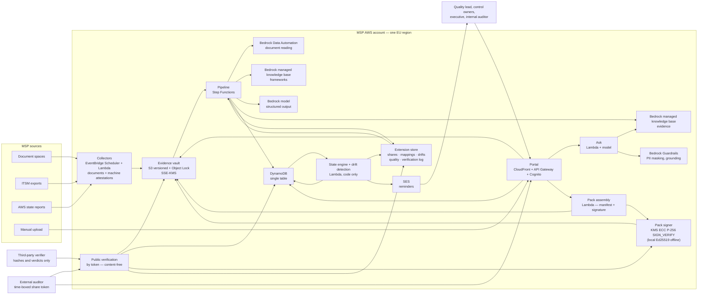
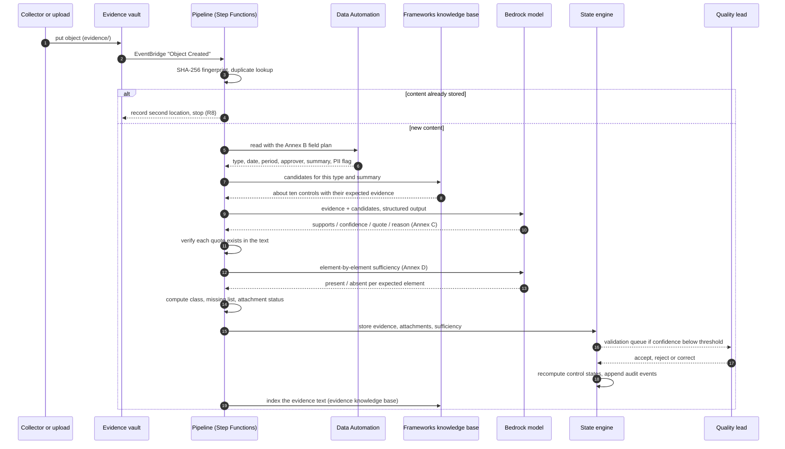
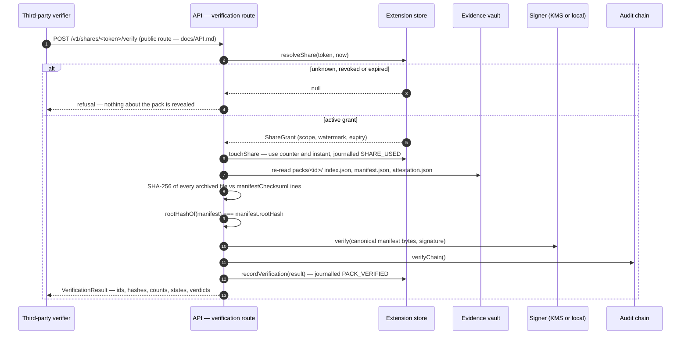
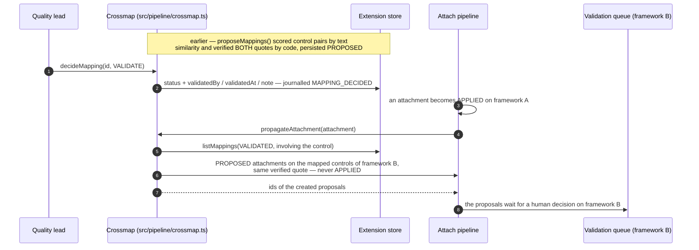

# Architecture

Registre is a continuous audit-evidence registry for AWS MSP partners. It reads
the documents a partner already produces, works out which controls of an
imported framework each document supports, watches freshness, and assembles an
audit pack on demand. It never decides whether a control is satisfied — it says
whether evidence exists, is fresh, and contains what the control expects.

Three extensions build on the same spine: a frozen pack is **signed and publicly
verifiable without exposing its content**, a validated **cross-framework
mapping** proposes an accepted attachment on an equivalent control, machine
attestations feed **same-day drift detection**, and the system **measures its
own quality** and degrades its auto-apply threshold when a metric fails. The
contracts of these four workstreams are in `docs/CONTRACTS-EXT.md`; the
endpoints they expose are documented in `docs/API.md` and are not repeated here.

Mermaid diagrams below: the deployment view, the sequence of one evidence, the
sequence of a third-party verification, and the sequence of an attachment
propagated through a mapping.

## 1. Overview

Every arrow that carries document text goes to a Bedrock service **in the same
region**. Nothing leaves the EU (ENF-DATA-01). The two arrows that carry no text
at all are the verification ones: a third party receives hashes, counts, states
and verdicts — never a title, never a quote (`VerificationResult` in
`src/domain/verification.ts`).

## 2. Processing one evidence

The two steps that matter most for trust are #8 (the code verifies the quote
really is in the document; a quote that cannot be found cancels the attachment,
acceptance R4) and #16 (states are computed by code from dates and
periodicities, never by a model — ENF-IA-04). The confidence compared at #14 is
not the raw setting: `src/pipeline/attach.ts` reads `attachmentThreshold()`
(`src/pipeline/quality.ts`), which raises the bar above 1 — everything to the
human — while the latest measured attachment accuracy fails its target
(§2.3, `docs/EVALUATION.md`).

A collector run that produces a **machine attestation**
(`provenance: 'MACHINE_ATTESTATION'`, `src/domain/verification.ts`) takes one
extra step: `src/pipeline/drift.ts` compares the attested state with the
previous one and emits a `DriftEvent` (`STATE_CHANGED`, `MISSING_RUN`,
`THRESHOLD_CROSSED`, `RECOVERED`) that moves the control within the day
(`src/domain/quality.ts`).

### 2.1 A third party verifies a pack (content-free)

Implemented by `verifyByToken` / `verifyPack` in `src/pipeline/verify.ts`. A
failed verdict is a **result**, never an exception: the verifier answers
`checksumsOk: false` rather than a 500. The manifest, its root hash and the
signature are written at freeze time by `src/pipeline/pack.ts` (`signManifest`,
`attestation.json` stored under the same retention as the archive); the same
archive can be checked offline, without the API, with `scripts/verify-pack.sh`
(bash + `openssl`). Security properties: `docs/SECURITY.md` §5.

### 2.2 An attachment propagates through a validated mapping

A mapping is a proposal until a human validates it (`MappingStatus` in
`src/domain/mapping.ts`), and propagation is again a proposal: the second
framework's quality lead decides with the same queue, the same quote check and
the same threshold as a first attachment. The `demo-iso` catalogue that
demonstrates the feature is fictional and written for this project
(`eval/catalogue-iso.ts`). Reuse is measured, not claimed: `reuseMetric()`
reports evidence carried over, attachments created and deposits avoided.

### 2.3 The system measures itself

Every proposal carries the version of the prompt that produced it
(`PROMPT_VERSIONS` in `src/ai/versioning.ts`, stamped on `Attachment.promptVersion`).
Evaluation runs — local scorer or Bedrock evaluation tasks — are recorded as
`QualityRecord`s per subject `(kind, model, promptVersion)` through
`recordEvaluation` (`src/pipeline/quality.ts`, journalled `QUALITY_RECORDED`),
persisted in the extension store, and displayed as a trend. The latest
`ACCEPTED_WITHOUT_CORRECTION` verdict feeds `effectiveConfidenceThreshold`
(`src/domain/quality.ts`): while it fails, the threshold in force is 1.01 —
unreachable — so nothing is auto-applied anywhere until a passing measurement
restores the configured setting. The loop is run by `tools/eval/runAndRecord.ts`
(`--check` fails the run on any metric below target); detail in
`docs/EVALUATION.md`.

## 3. Components and AWS services

| Component | AWS services | Responsibility | Stack |
|---|---|---|---|
| Collectors | EventBridge Scheduler, Lambda (Node 22) | Fetch evidence, write a dated file into the vault; produce machine attestations with an attested state | `Registre-Collectors` |
| Evidence vault | S3 (versioning, Object Lock), KMS | Immutable, encrypted, versioned storage (ENF-INT-01) | `Registre-Vault` |
| State store | DynamoDB (single table, 2 GSIs, PITR) | Frameworks, controls, evidence, attachments, sufficiency, states, reminders, validations, packs, audit log | `Registre-Data` |
| Extension store | Same DynamoDB table (`src/store/extensionsDynamo.ts`), in-memory twin for offline runs | Share grants, cross-framework mappings, drift events, quality records, verification log (`ExtensionStore` port in `src/ports/index.ts`) | `Registre-Data` |
| Pipeline | Step Functions, Lambda | Fingerprint → dedupe → read → candidates → attach → sufficiency → states → index | `Registre-Pipeline` |
| Reader | Bedrock Data Automation | Extract the Annex B fields from PDF, Office, spreadsheet, image | `Registre-Bedrock` |
| Framework retrieval | Bedrock managed knowledge base | Return candidate controls for one evidence | `Registre-Bedrock` |
| Evidence retrieval | Bedrock managed knowledge base | Passage search for the ask endpoint | `Registre-Bedrock` |
| Reasoning | Bedrock model, structured output | Attachments (Annex C) and sufficiency (Annex D) | `Registre-Bedrock` |
| Protection | Bedrock Guardrails | PII anonymisation, contextual grounding | `Registre-Bedrock` |
| State engine + drift | Lambda | Freshness, control states, readiness, reminders; drift detection on machine attestations (`src/pipeline/drift.ts`, cadence `RefreshPolicy` in `src/domain/quality.ts`) | `Registre-Pipeline` |
| Cross-framework mapping | Lambda, code-side similarity | Propose control equivalences with two code-verified quotes, human validation, attachment propagation (`src/pipeline/crossmap.ts`) | `Registre-Pipeline` |
| Pack signer | KMS asymmetric key `ECC_NIST_P256`, usage `SIGN_VERIFY`, rotation deliberately disabled (`infra/lib/vault-stack.ts`); local Ed25519 offline (`src/crypto/localSigner.ts`) | Sign the canonical manifest of every frozen pack; verify on demand | `Registre-Vault` (key), `Registre-Api` (env wiring) |
| Public verification | API Gateway (public route), Lambda | Recompute checksums, root hash, signature and audit chain; answer with a content-free `VerificationResult` (`src/pipeline/verify.ts`) | `Registre-Api` |
| Auditor shares | API Gateway, Lambda | Time-boxed (1–168 h), revocable, watermarked tokens; every use journalled (`src/pipeline/share.ts`) | `Registre-Api` |
| Measured quality | evaluation harness, extension store | Records metrics per prompt version, trend per subject, effective attachment threshold (`src/pipeline/quality.ts`, `tools/eval/runAndRecord.ts`) | `Registre-Pipeline` |
| API | API Gateway HTTP API, Lambda, Cognito | The endpoints of chapter 15 plus the extension routes of `docs/API.md`, RBAC | `Registre-Api` |
| Portal | S3, CloudFront (OAC) | Readiness, validation queue, evidence, ask, packs, audit log, mappings, drifts, quality, shares | `Registre-Portal` |
| Notifications | SES, EventBridge Scheduler | Expiry reminders and the weekly digest; reminders carry drift detail | `Registre-Notify` |
| Observability | CloudWatch, SNS, AWS Budgets | One alarm per function, dashboard, budget alert | `Registre-Observability` |

## 4. Bedrock function → usage → why

| Bedrock function | Where it is used | Why this function and not something else |
|---|---|---|
| **Managed knowledge bases** | Two of them: `kb-frameworks` (control text, one chunk per control) and `kb-evidence` (evidence text with access level as metadata). | Bedrock owns ingestion, chunking, storage and search, so there is no vector database to operate. Native connectors (S3 today, SharePoint/Confluence/Drive/OneDrive next) match where MSP evidence actually lives (EF-COL-06). Retrieval is what turns "read this document" into "these ten controls are worth checking" — without it the model would see 150 controls per evidence. |
| **Data Automation** | Reading each evidence with a field plan derived from Annex B (type, title, document date, covered period, version, author, approver, client, summary, PII flag). | Purpose-built document extraction with a custom output schema and built-in sensitive-data detection: exactly the two things the reader needs. It handles scanned PDFs and screenshots, which a text-only parser cannot (EF-LEC-01..04). |
| **Structured outputs** | Attachment proposals (Annex C) and sufficiency assessments (Annex D). | The model must return a typed object the code can validate and store. Free text would push parsing into the codebase and let a malformed answer reach the store. The schema also keeps the model inside its lane: it returns booleans, confidences, quotes and short reasons — never a control state (ENF-IA-04). |
| **Guardrails** | Two jobs: anonymise PII in answers and excerpts (ENF-CONF-02), and check that an answer is grounded in the retrieved passages (ENF-IA-02). | A groundedness check at the boundary is the last line of defence: an unanchored draft is replaced by "No evidence answers this question" instead of reaching an auditor (EF-QR-02, R12). PII anonymisation in the same call means a redaction rule cannot be forgotten in a new code path. |
| **Evaluation tasks** | Model-as-judge task on the attachment dataset (custom metrics `attachment_set_matches`, `attachment_quote_grounded`) and knowledge-base evaluation task on the Q&A dataset (Correctness, Completeness, Helpfulness, Faithfulness). Their outcomes are **recorded as measured quality** and drive the effective attachment threshold (§2.3). | Regression testing of a prompt change is the difference between a demo and a product. The judge runs on every prompt or model change; the same dataset doubles as the acceptance evidence for R3 and R11 — and because the verdicts feed `effectiveConfidenceThreshold`, a failing measurement stops auto-application instead of being a note in a report (see `docs/EVALUATION.md`). |
| **Flex service tier** | Nightly collectors, the backfill of existing documents, the weekly digest. | Batch work tolerates latency; Flex costs a fraction of standard throughput. Interactive calls (portal upload, ask) stay on the standard tier so a judge never waits (ENF-COUT-01). |
| **Prompt caching** | The attachment prompt: framework excerpt + instructions are a long, stable prefix, reused for every evidence of a batch. | The candidate list and the instruction block repeat verbatim across dozens of calls in one night. Caching the prefix removes most input tokens from the bill and shortens latency; it is also what makes a 1,000-document backfill affordable (ENF-PERF-01). |

Cross-framework mapping deliberately adds **no new model usage**: candidate
equivalences are scored by the existing code-side `similarity()` over requirement
texts, with both quotes verified by code (`src/pipeline/crossmap.ts` contract in
`docs/CONTRACTS-EXT.md` §3). Signing and verification use KMS, not Bedrock.

## 5. Why these boundaries

- **Ports and adapters.** `src/ports/index.ts` declares every boundary (reader,
  retrievers, reasoner, guardrail, stores, notifier, **signer**, **extension
  store**). The same product runs offline against deterministic mocks — that is
  how the demo and the whole test suite run without a network call — and on AWS
  with the Bedrock adapters. The extensions follow the same rule:
  `MemoryExtensionStore` and `LocalSigner` offline (`src/store/extensionsMemory.ts`,
  `src/crypto/localSigner.ts`), `DynamoExtensionStore` and `KmsSigner` on AWS.
- **One Lambda per step.** A failure in reading does not force a re-read of the
  candidates, and each step has its own memory, timeout and alarm.
- **One table.** Every entity of chapter 14 — and every extension entity — lives
  in one DynamoDB table behind one backup policy, one key and one
  point-in-time recovery setting.
- **Code computes, the model reads.** Dates, periodicities, states, counts,
  sufficiency classes and missing lists are computed in `src/domain/**`. This is
  the single most important design decision: it is what allows the product to
  make a claim an auditor can check. Drift kinds, root hashes, verdicts, reuse
  factors and the effective threshold obey the same rule.
- **Verification never leaks content.** The public route answers with the fields
  of `VerificationResult` and nothing else; a share grant narrows access (one
  pack or one framework, bounded in time), it never widens it.
- **The framework is imported, never shipped.** No protected framework text is
  in the repository; each partner imports its own file (EF-REF-03, ENF-CONF-03).
  The second demonstration framework (`demo-iso`) is fictional and written for
  this project, like `demo-msp`.
