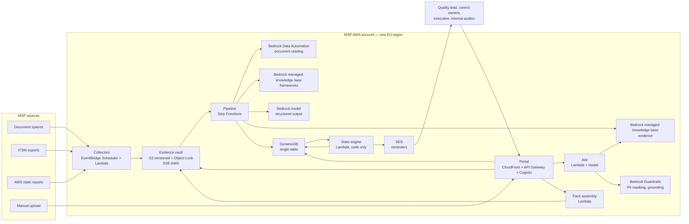
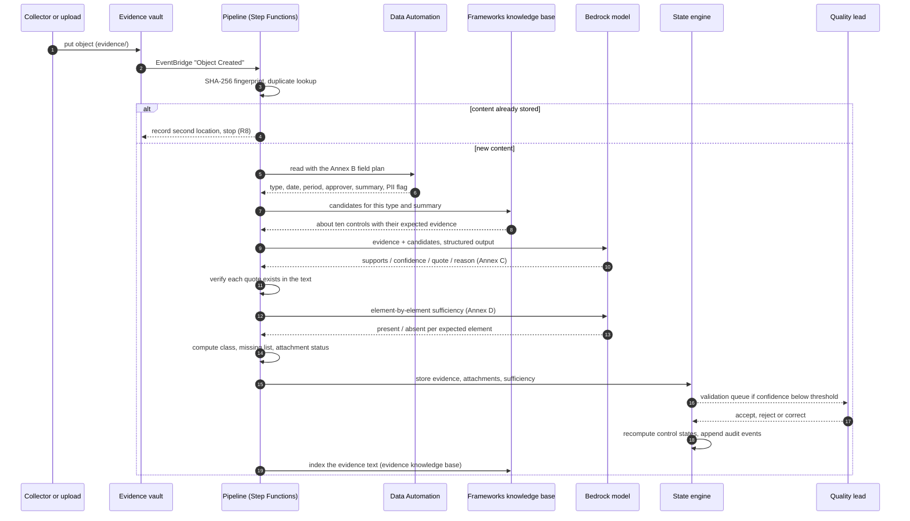

# Architecture

Registre is a continuous audit-evidence registry for AWS MSP partners. It reads
the documents a partner already produces, works out which controls of an
imported framework each document supports, watches freshness, and assembles an
audit pack on demand. It never decides whether a control is satisfied — it says
whether evidence exists, is fresh, and contains what the control expects.

Two mermaid diagrams below: the deployment view and the sequence of one evidence.

## 1. Overview

Every arrow that carries document text goes to a Bedrock service **in the same
region**. Nothing leaves the EU (ENF-DATA-01).

## 2. Processing one evidence

The two steps that matter most for trust are #8 (the code verifies the quote
really is in the document; a quote that cannot be found cancels the attachment,
acceptance R4) and #16 (states are computed by code from dates and
periodicities, never by a model — ENF-IA-04).

## 3. Components and AWS services

| Component | AWS services | Responsibility | Stack |
|---|---|---|---|
| Collectors | EventBridge Scheduler, Lambda (Node 22) | Fetch evidence, write a dated file into the vault | `Registre-Collectors` |
| Evidence vault | S3 (versioning, Object Lock), KMS | Immutable, encrypted, versioned storage (ENF-INT-01) | `Registre-Vault` |
| State store | DynamoDB (single table, 2 GSIs, PITR) | Frameworks, controls, evidence, attachments, sufficiency, states, reminders, validations, packs, audit log | `Registre-Data` |
| Pipeline | Step Functions, Lambda | Fingerprint → dedupe → read → candidates → attach → sufficiency → states → index | `Registre-Pipeline` |
| Reader | Bedrock Data Automation | Extract the Annex B fields from PDF, Office, spreadsheet, image | `Registre-Bedrock` |
| Framework retrieval | Bedrock managed knowledge base | Return candidate controls for one evidence | `Registre-Bedrock` |
| Evidence retrieval | Bedrock managed knowledge base | Passage search for the ask endpoint | `Registre-Bedrock` |
| Reasoning | Bedrock model, structured output | Attachments (Annex C) and sufficiency (Annex D) | `Registre-Bedrock` |
| Protection | Bedrock Guardrails | PII anonymisation, contextual grounding | `Registre-Bedrock` |
| State engine | Lambda | Freshness, control states, readiness, reminders | `Registre-Pipeline` |
| API | API Gateway HTTP API, Lambda, Cognito | The sixteen endpoints of chapter 15, RBAC | `Registre-Api` |
| Portal | S3, CloudFront (OAC) | Readiness, validation queue, evidence, ask, packs, audit log | `Registre-Portal` |
| Notifications | SES, EventBridge Scheduler | Expiry reminders and the weekly digest | `Registre-Notify` |
| Observability | CloudWatch, SNS, AWS Budgets | One alarm per function, dashboard, budget alert | `Registre-Observability` |

## 4. Bedrock function → usage → why

| Bedrock function | Where it is used | Why this function and not something else |
|---|---|---|
| **Managed knowledge bases** | Two of them: `kb-frameworks` (control text, one chunk per control) and `kb-evidence` (evidence text with access level as metadata). | Bedrock owns ingestion, chunking, storage and search, so there is no vector database to operate. Native connectors (S3 today, SharePoint/Confluence/Drive/OneDrive next) match where MSP evidence actually lives (EF-COL-06). Retrieval is what turns "read this document" into "these ten controls are worth checking" — without it the model would see 150 controls per evidence. |
| **Data Automation** | Reading each evidence with a field plan derived from Annex B (type, title, document date, covered period, version, author, approver, client, summary, PII flag). | Purpose-built document extraction with a custom output schema and built-in sensitive-data detection: exactly the two things the reader needs. It handles scanned PDFs and screenshots, which a text-only parser cannot (EF-LEC-01..04). |
| **Structured outputs** | Attachment proposals (Annex C) and sufficiency assessments (Annex D). | The model must return a typed object the code can validate and store. Free text would push parsing into the codebase and let a malformed answer reach the store. The schema also keeps the model inside its lane: it returns booleans, confidences, quotes and short reasons — never a control state (ENF-IA-04). |
| **Guardrails** | Two jobs: anonymise PII in answers and excerpts (ENF-CONF-02), and check that an answer is grounded in the retrieved passages (ENF-IA-02). | A groundedness check at the boundary is the last line of defence: an unanchored draft is replaced by "No evidence answers this question" instead of reaching an auditor (EF-QR-02, R12). PII anonymisation in the same call means a redaction rule cannot be forgotten in a new code path. |
| **Evaluation tasks** | Model-as-judge task on the attachment dataset (custom metrics `attachment_set_matches`, `attachment_quote_grounded`) and knowledge-base evaluation task on the Q&A dataset (Correctness, Completeness, Helpfulness, Faithfulness). | Regression testing of a prompt change is the difference between a demo and a product. The judge runs on every prompt or model change; the same dataset doubles as the acceptance evidence for R3 and R11 (see `docs/EVALUATION.md`). |
| **Flex service tier** | Nightly collectors, the backfill of existing documents, the weekly digest. | Batch work tolerates latency; Flex costs a fraction of standard throughput. Interactive calls (portal upload, ask) stay on the standard tier so a judge never waits (ENF-COUT-01). |
| **Prompt caching** | The attachment prompt: framework excerpt + instructions are a long, stable prefix, reused for every evidence of a batch. | The candidate list and the instruction block repeat verbatim across dozens of calls in one night. Caching the prefix removes most input tokens from the bill and shortens latency; it is also what makes a 1,000-document backfill affordable (ENF-PERF-01). |

## 5. Why these boundaries

- **Ports and adapters.** `src/ports/index.ts` declares every boundary (reader,
  retrievers, reasoner, guardrail, stores, notifier). The same product runs
  offline against deterministic mocks — that is how the demo and the whole test
  suite run without a network call — and on AWS with the Bedrock adapters.
- **One Lambda per step.** A failure in reading does not force a re-read of the
  candidates, and each step has its own memory, timeout and alarm.
- **One table.** Every entity of chapter 14 lives in one DynamoDB table behind
  one backup policy, one key and one point-in-time recovery setting.
- **Code computes, the model reads.** Dates, periodicities, states, counts,
  sufficiency classes and missing lists are computed in `src/domain/**`. This is
  the single most important design decision: it is what allows the product to
  make a claim an auditor can check.
- **The framework is imported, never shipped.** No protected framework text is
  in the repository; each partner imports its own file (EF-REF-03, ENF-CONF-03).
