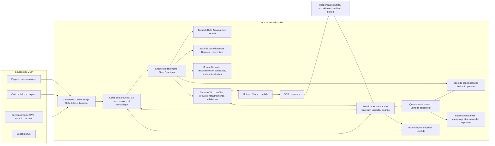
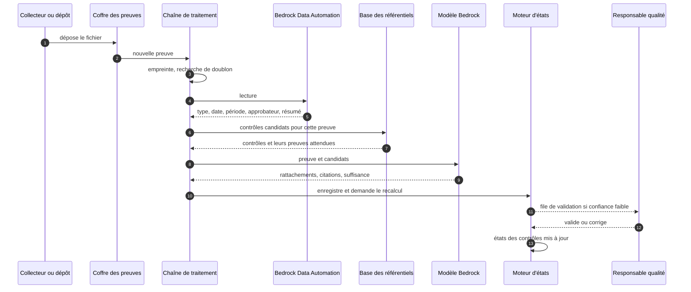

# Cahier des charges — Preuves d'audit en continu

**Nom de travail : Registre** (à changer librement)
Version 1.0 du 11 novembre 2026 — Hackathon AWS MSP AI, Track 1

> Ce document est en français pour le travail interne. Tous les livrables de la soumission (description, vidéo, schéma d'architecture, document de conception) doivent être en anglais.
>
> Les faits marqués **(vérifié)** ont été lus sur les pages et dans la documentation AWS le 11 novembre 2026 (sources en annexe E). Tout ce qui reste à confirmer est regroupé au chapitre 24.
>
> La liste de validation du programme AWS MSP n'est accessible qu'aux partenaires connectés à AWS Partner Central. Je ne l'ai pas lue. Ce document n'en reproduit rien, et la démonstration ne doit pas la montrer (chapitre 16).

---

## 1. Fiche d'identité

| Élément | Valeur |
|---|---|
| Track | 1 — Run Your MSP Better |
| Objet | Opérations internes du MSP : préparation des audits et tenue de la conformité |
| Prix spécial visé | Best Amazon Bedrock Application |
| Services IA AWS | Amazon Bedrock : base de connaissances managée, Data Automation, modèles avec sorties structurées, Guardrails, tâches d'évaluation, niveau de service Flex |
| Utilisateurs | Responsable qualité et conformité, propriétaires de contrôles, direction, auditeur interne |
| Référentiels visés | Liste de validation du programme AWS MSP, ISO 27001, et tout référentiel importé |
| Échéance de soumission | Vendredi 11 décembre 2026, 12h00 PT (21h00 à Paris) |
| Fin du jugement | 22 janvier 2027 : la solution doit rester en ligne jusque-là |

## 2. Résumé

Pour obtenir et garder la validation du programme AWS MSP, un partenaire passe un audit mené par un tiers. Il en va de même pour ISO 27001. À chaque fois, l'équipe passe des semaines à retrouver des preuves éparpillées : une politique dans un espace documentaire, un compte rendu de test de restauration dans un ticket, une liste de certifications dans un tableur.

Registre fait ce travail toute l'année, au lieu de le faire dans l'urgence. Un agent :

1. **Collecte** les preuves là où elles se trouvent.
2. **Lit** chaque preuve : sa nature, sa date, la période couverte, son approbateur.
3. **Rattache** chaque preuve aux contrôles qu'elle soutient, en citant le passage qui le justifie.
4. **Surveille** la fraîcheur : chaque contrôle a une périodicité, chaque preuve une date.
5. **Signale** les contrôles sans preuve à jour et relance leur propriétaire.
6. **Assemble** le dossier d'audit à la demande.

Registre ne dit jamais qu'un contrôle est « conforme ». Il dit si une preuve existe, si elle est à jour et si elle contient ce qui est attendu. Le jugement de conformité reste à l'auditeur.

## 3. Contexte et problème

### 3.1 Le problème du MSP

- **Preuves éparpillées :** documents, tickets, exports d'outils, captures d'écran, dans une dizaine d'endroits.
- **Travail par à-coups :** rien pendant onze mois, puis plusieurs semaines de collecte avant l'audit.
- **Preuves périmées :** une politique non revue depuis deux ans est découverte la veille.
- **Dépendance à une personne :** seul le responsable qualité sait où se trouve quoi.
- **Plusieurs référentiels :** la même preuve sert à deux audits, mais elle est cherchée deux fois.

### 3.2 Ce que dit AWS (vérifié)

| Sujet | Fait |
|---|---|
| Programme AWS MSP | Pour être validé, un partenaire doit réussir un audit rigoureux mené par un tiers, qui évalue ses compétences techniques et la santé de son entreprise. |
| Préparation | Le partenaire revoit la liste de validation du programme et prépare une auto-évaluation à l'aide de guides de calibration. Ces documents sont dans AWS Partner Central, derrière une connexion. |
| Version | Le lien vers les guides de calibration mentionne la version 7.0 de la liste de validation. |
| AWS Audit Manager | Ce service automatisait la collecte de preuves sur l'usage d'AWS. **Il n'est plus ouvert aux nouveaux clients** ; les clients existants peuvent continuer à l'utiliser. |

### 3.3 Pourquoi un outil sur Bedrock

| Constat | Conséquence |
|---|---|
| Audit Manager est fermé aux nouveaux clients | Un MSP qui démarre aujourd'hui n'a pas d'outil AWS de collecte de preuves à activer |
| Audit Manager visait les preuves tirées des ressources AWS | Un audit de MSP porte surtout sur l'organisation : politiques, procédures, comptes rendus, formation, satisfaction des clients. Ce sont des documents |
| Lire un document et dire quel contrôle il soutient demande de comprendre le texte | C'est un travail pour un modèle de langage, pas pour une règle |
| Les preuves sont dans des outils documentaires | La base de connaissances managée de Bedrock se connecte nativement à S3, SharePoint, Confluence, Google Drive et OneDrive **(vérifié)** |

## 4. Objectifs et indicateurs

### 4.1 Indicateurs du projet

| Indicateur | Définition | Situation de départ | Cible démo | Cible production |
|---|---|---|---|---|
| Jours de préparation d'audit | Jours-personnes entre le lancement de la préparation et le dossier complet | Plusieurs semaines (hypothèse à valider) | Dossier assemblé en moins de 10 minutes sur les données de démonstration | Moins de 5 jours-personnes |
| Contrôles sans preuve à jour | Contrôles à l'état « sans preuve » ou « périmé », en nombre et en part | Inconnu jusqu'à l'audit | Affiché en continu ; les cas semés sont tous détectés | Moins de 5 % à tout moment |
| Rattachements acceptés | Rattachements proposés que le responsable qualité accepte sans correction | — | Plus de 85 % | Plus de 90 % |
| Lecture des preuves | Champs extraits justes (type, date, période, approbateur) | — | Plus de 90 % | Plus de 95 % |
| Délai de réponse à l'auditeur | Entre une demande de preuve et sa fourniture | Heures à jours | Moins de 1 minute | Moins de 5 minutes |
| Temps humain par preuve | Minutes de validation par preuve entrée | — | Mesuré | Moins de 1 minute |
| Anticipation | Part des preuves renouvelées avant leur péremption | — | Affiché | Plus de 90 % |

### 4.2 Gains d'efficacité visés

Le Track 1 demande des gains mesurables. Ceux-ci sont à chiffrer dans la soumission :

- **Temps de préparation :** de plusieurs semaines concentrées à un suivi de quelques minutes par semaine.
- **Risque :** aucun contrôle sans preuve découvert la veille de l'audit.
- **Réutilisation :** une preuve rattachée une fois sert à tous les référentiels qu'elle soutient.

Les états, les dates et les comptages sont calculés par le code. Le modèle de langage n'en calcule aucun.

## 5. Périmètre

### 5.1 Inclus dans la version du hackathon

- Un MSP fictif et un référentiel de démonstration de 30 contrôles, écrit pour l'occasion.
- Environ 60 preuves générées : politiques, procédures, comptes rendus, exports de tickets, captures d'écran, listes.
- Collecte depuis un compartiment S3, un dépôt manuel et deux collecteurs automatiques.
- Lecture des preuves avec Bedrock Data Automation.
- Rattachement aux contrôles avec justification et citation.
- Contrôle de suffisance au regard des preuves attendues.
- États des contrôles, fraîcheur, relances aux propriétaires.
- Questions-réponses avec citations.
- Dossier d'audit exportable.
- Portail de validation.

### 5.2 Cible après le hackathon

- Connecteurs SharePoint, Confluence, Google Drive, OneDrive.
- Collecteurs AWS étendus : sauvegardes, configuration, accès.
- Correspondance entre référentiels : une preuve proposée pour ISO 27001 quand elle soutient un contrôle équivalent du programme MSP.
- Rédaction assistée des preuves manquantes à partir de modèles.
- Espace de consultation pour l'auditeur externe.

### 5.3 Exclu

- Le jugement de conformité.
- La rédaction des politiques à la place du MSP.
- La mise en conformité technique des environnements.
- La publication ou la revente de référentiels protégés.

## 6. Utilisateurs et rôles

| Rôle | Ce qu'il fait | Droits |
|---|---|---|
| Responsable qualité et conformité | Importe les référentiels, valide les rattachements, prépare le dossier | Tout |
| Propriétaire de contrôle | Fournit et renouvelle les preuves de ses contrôles | Ses contrôles, dépôt de preuves |
| Direction | Suit l'état de préparation | Lecture des tableaux de bord |
| Auditeur interne | Pose des questions, vérifie des preuves | Lecture, questions-réponses |
| Administrateur | Branche les sources, gère les accès | Technique |

## 7. Reproductibilité chez d'autres partenaires

- **Référentiel importé, non intégré :** l'outil ne contient aucun référentiel. Chaque partenaire importe le sien, depuis un fichier, y compris la liste de validation du programme MSP qu'il télécharge lui-même.
- **Collecteurs remplaçables :** une interface par type de source.
- **Installation en code :** un README, une commande.
- **Aucune donnée partagée :** chaque partenaire installe l'outil dans son propre compte.

Tout partenaire visant la validation MSP rencontre ce problème. C'est ce qui rend le projet reproductible dans les environnements de partenaires, comme le demande le critère de conception.

## 8. Parcours

### 8.1 Installation

1. Le responsable qualité importe un référentiel : pour chaque contrôle, son identifiant, son exigence, les preuves attendues, sa périodicité et son propriétaire.
2. L'administrateur branche les sources documentaires et active les collecteurs.
3. Un premier passage lit tout l'existant et propose les rattachements.
4. Le responsable qualité valide les rattachements incertains. L'état initial apparaît : contrôles couverts, périmés, sans preuve.

### 8.2 En continu

1. Une nouvelle preuve arrive : document déposé, export nocturne, collecte automatique.
2. Elle est lue, rattachée, contrôlée.
3. L'état des contrôles concernés est recalculé.
4. Si le rattachement est sûr, il est appliqué. Sinon il attend une validation.

### 8.3 Chaque semaine

- Le propriétaire d'un contrôle dont la preuve expire dans 30 jours reçoit une relance qui dit quoi fournir.
- Le responsable qualité reçoit le point de la semaine : ce qui a changé, ce qui manque, ce qui attend sa validation.

### 8.4 Avant un audit

1. Le responsable qualité ouvre l'état de préparation du référentiel.
2. Il traite les derniers manques.
3. Il lance l'assemblage du dossier : index par contrôle, preuves, liste des écarts connus.

### 8.5 Pendant un audit

L'auditeur demande une preuve. Le responsable qualité pose la question à Registre : « Montre le dernier test de restauration et sa durée de reprise ». La réponse cite le document, la page et la date.

## 9. Exigences fonctionnelles

Priorité : **M** indispensable pour la démonstration, **S** souhaitable, **C** cible après le hackathon.

### 9.1 Référentiels

| Réf. | Priorité | Exigence |
|---|---|---|
| EF-REF-01 | M | Importer un référentiel depuis un fichier : contrôles, exigences, preuves attendues, périodicité, propriétaire. |
| EF-REF-02 | M | Gérer plusieurs référentiels et plusieurs versions d'un même référentiel. |
| EF-REF-03 | M | Garder le texte des référentiels dans le compte du partenaire, sans jamais l'exposer hors des rôles autorisés. |
| EF-REF-04 | S | Proposer la correspondance entre contrôles de deux référentiels, validée par un humain. |
| EF-REF-05 | S | Lors d'un changement de version, signaler les contrôles ajoutés, modifiés ou retirés. |

### 9.2 Collecte

| Réf. | Priorité | Exigence |
|---|---|---|
| EF-COL-01 | M | Collecter les documents d'un compartiment S3. |
| EF-COL-02 | M | Recevoir un dépôt manuel depuis le portail, avec le contrôle visé en option. |
| EF-COL-03 | M | Collecteur d'exports de tickets : incidents, changements, problèmes, sur une période. |
| EF-COL-04 | M | Collecteur AWS : rapport daté d'un état (par exemple les sauvegardes du mois), produit en fichier. |
| EF-COL-05 | M | Calculer l'empreinte de chaque fichier ; écarter les doublons ; garder les versions. |
| EF-COL-06 | S | Connecteurs SharePoint, Confluence, Google Drive, OneDrive. |
| EF-COL-07 | C | Réception par transfert d'e-mail. |

### 9.3 Lecture

| Réf. | Priorité | Exigence |
|---|---|---|
| EF-LEC-01 | M | Extraire de chaque preuve les champs de l'annexe B avec Bedrock Data Automation. |
| EF-LEC-02 | M | Traiter les PDF, les documents bureautiques, les tableurs et les images. |
| EF-LEC-03 | M | Repérer les données personnelles et les masquer dans les extraits affichés. |
| EF-LEC-04 | M | Signaler une preuve illisible, sans date ou sans auteur. |

### 9.4 Rattachement et suffisance

| Réf. | Priorité | Exigence |
|---|---|---|
| EF-RAT-01 | M | Proposer, pour chaque preuve, les contrôles qu'elle soutient, avec un niveau de confiance. |
| EF-RAT-02 | M | Justifier chaque rattachement par un passage cité de la preuve et par l'exigence du contrôle. |
| EF-RAT-03 | M | Appliquer seul un rattachement au-dessus du seuil de confiance ; soumettre les autres à validation. |
| EF-RAT-04 | M | Permettre qu'une preuve soutienne plusieurs contrôles, et plusieurs référentiels. |
| EF-RAT-05 | M | Ne rattacher à aucun contrôle une preuve qui n'en soutient aucun. |
| EF-SUF-01 | M | Comparer la preuve à la liste des preuves attendues du contrôle et lister ce qui manque. |
| EF-SUF-02 | M | Classer la suffisance : complète, partielle, à vérifier. Jamais « conforme ». |
| EF-SUF-03 | S | Réutiliser les décisions passées du responsable qualité sur des preuves du même type. |

### 9.5 Fraîcheur, états, relances

| Réf. | Priorité | Exigence |
|---|---|---|
| EF-FRA-01 | M | Calculer la date de péremption de chaque preuve à partir de sa date et de la périodicité du contrôle. |
| EF-FRA-02 | M | Calculer l'état de chaque contrôle selon le chapitre 12. |
| EF-FRA-03 | M | Afficher l'état de préparation par référentiel : parts couvertes, à renouveler, périmées, sans preuve, à vérifier. |
| EF-FRA-04 | M | Garder l'historique des états, pour montrer la tendance. |
| EF-REL-01 | M | Relancer le propriétaire 30 jours avant la péremption, en disant quelle preuve fournir. |
| EF-REL-02 | M | Relancer pour un contrôle sans preuve. |
| EF-REL-03 | S | Point hebdomadaire au responsable qualité. |
| EF-REL-04 | S | Créer la relance comme un ticket dans l'outil du MSP. |

### 9.6 Questions-réponses et dossier

| Réf. | Priorité | Exigence |
|---|---|---|
| EF-QR-01 | M | Répondre en langage naturel à partir des preuves, avec le document, la page et la date cités. |
| EF-QR-02 | M | Dire qu'aucune preuve ne répond, plutôt que d'en déduire une. |
| EF-QR-03 | M | Respecter les droits : une preuve réservée n'est pas citée à qui n'y a pas accès. |
| EF-DOS-01 | M | Assembler le dossier d'audit d'un référentiel : index par contrôle, preuves, dates, écarts connus. |
| EF-DOS-02 | M | Exporter le dossier en archive, avec un index lisible. |
| EF-DOS-03 | S | Figer un dossier à une date, pour pouvoir le reproduire. |

### 9.7 Validation et administration

| Réf. | Priorité | Exigence |
|---|---|---|
| EF-VAL-01 | M | File de validation : rattachements incertains, suffisances partielles, preuves illisibles. |
| EF-VAL-02 | M | Chaque validation garde son auteur, sa date et son motif. |
| EF-ADM-01 | M | Réglages : seuil de confiance, délai de relance, périodicités par défaut. |
| EF-ADM-02 | M | Journal de toutes les actions : collecte, lecture, rattachement, validation, export. |
| EF-ADM-03 | M | Identifiants de démonstration pour les juges. |

## 10. Exigences non fonctionnelles

| Réf. | Exigence |
|---|---|
| ENF-INT-01 | Intégrité : chaque preuve est conservée avec son empreinte, en versions, dans un stockage que l'on ne peut pas modifier ni effacer avant la fin de la durée de conservation. |
| ENF-INT-02 | Le journal des actions n'est pas modifiable. |
| ENF-CONF-01 | Accès par rôle. Les preuves contenant des données sociales ou des données de clients ont un accès restreint. |
| ENF-CONF-02 | Les données personnelles sont masquées dans les extraits et les réponses. |
| ENF-CONF-03 | Le texte d'un référentiel protégé n'apparaît dans aucun export destiné à l'extérieur, sauf décision du partenaire. |
| ENF-SEC-01 | Chiffrement au repos (KMS) et en transit. |
| ENF-IA-01 | L'outil n'emploie jamais le mot « conforme » pour un contrôle. |
| ENF-IA-02 | Toute affirmation d'une réponse est appuyée sur une citation vérifiable. |
| ENF-IA-03 | Le contenu des preuves est une donnée, jamais une instruction pour l'agent. |
| ENF-IA-04 | Les états, les dates et les comptages sont calculés par le code. |
| ENF-PERF-01 | Lecture et rattachement d'une preuve en moins de 2 minutes. Reprise de 1 000 documents existants en une nuit. |
| ENF-COUT-01 | Traitements nocturnes au niveau de service Flex. Coût par preuve mesuré et affiché. |
| ENF-REP-01 | Infrastructure en code, référentiel importé, collecteurs remplaçables. |
| ENF-DATA-01 | Hébergement dans l'Union européenne. Conservation : durée du cycle d'audit plus un an, réglable. |
| ENF-OBS-01 | Supervision de chaque collecte et de chaque lecture, alarmes sur les échecs. |

## 11. Architecture technique

### 11.1 Vue d'ensemble



### 11.2 Composants

| Composant | Service AWS | Rôle |
|---|---|---|
| Collecteurs | EventBridge Scheduler, Lambda | Vont chercher les preuves, produisent des fichiers datés |
| Coffre des preuves | S3 avec gestion des versions et verrouillage des objets | Conservation intègre |
| Chaîne de traitement | Step Functions, Lambda | Empreinte, doublons, lecture, rattachement, suffisance, indexation |
| Lecture | Bedrock Data Automation | Extraction des champs d'une preuve selon un plan de champs |
| Référentiels | Base de connaissances managée de Bedrock | Retrouver les contrôles candidats pour une preuve |
| Preuves | Base de connaissances managée de Bedrock | Recherche et questions-réponses avec citations |
| Raisonnement | Modèle Bedrock, sorties structurées | Rattachement et suffisance |
| Protection | Bedrock Guardrails | Masquage des données personnelles, réponses ancrées dans les sources |
| Moteur d'états | Lambda | Fraîcheur, état des contrôles, relances |
| Portail | CloudFront, S3, API Gateway, Lambda, Cognito | Tableaux de bord, validation, questions, export |
| État | DynamoDB | Contrôles, preuves, rattachements, validations, historique |
| Relances | SES | E-mails aux propriétaires |
| Infrastructure en code | AWS CDK | Reproductibilité |

### 11.3 Usage de Bedrock, fonction par fonction

| Fonction Bedrock | Usage | Fait vérifié |
|---|---|---|
| Base de connaissances managée | Deux bases : référentiels et preuves | Bedrock gère l'ingestion, le stockage, l'indexation et la recherche ; sept connecteurs natifs, dont S3, SharePoint, Confluence, Google Drive et OneDrive ; recherche agentique |
| Data Automation | Lecture des preuves | Sortie standard ou sortie personnalisée par plan de champs pour les documents, les images et l'audio ; détection et masquage de données sensibles |
| Sorties structurées | Rattachement et suffisance au format des annexes C et D | Fonction présente dans le guide |
| Guardrails | Masquage, ancrage des réponses | Fonction présente ; filtres précis à confirmer |
| Tâches d'évaluation | Non-régression du rattachement (modèle juge) et des questions-réponses (évaluation de base de connaissances) | Tâches d'évaluation par modèle juge avec métriques personnalisées ; tâches d'évaluation de base de connaissances |
| Niveau Flex | Traitements nocturnes à prix réduit | Niveau à prix réduit pour les traitements qui tolèrent un délai |
| Cache de prompts | La liste des contrôles candidats est un préfixe long et répété | Fonction présente dans le guide |

### 11.4 Traitement d'une preuve



## 12. États et règles

### 12.1 État d'un rattachement

| État | Sens |
|---|---|
| Proposé | Confiance sous le seuil, en attente de validation |
| Appliqué | Confiance au-dessus du seuil, ou validé par un humain |
| Rejeté | Écarté par un humain |

### 12.2 État d'une preuve pour un contrôle

| État | Règle |
|---|---|
| À jour | Date de la preuve plus périodicité du contrôle postérieure à aujourd'hui, de plus de 30 jours |
| À renouveler | Péremption dans moins de 30 jours |
| Périmée | Date de péremption dépassée |

Pour une preuve qui couvre une période (un export trimestriel), la date retenue est la fin de la période couverte.

### 12.3 État d'un contrôle

| État | Règle | Couleur |
|---|---|---|
| Couvert | Au moins une preuve appliquée, à jour, de suffisance complète | Vert |
| À renouveler | La meilleure preuve est « à renouveler » | Jaune |
| À vérifier | Seulement des rattachements proposés, ou une suffisance partielle | Orange |
| Périmé | Toutes les preuves appliquées sont périmées | Rouge |
| Sans preuve | Aucune preuve appliquée | Rouge |

### 12.4 Règles de prudence

- Le doute va vers « à vérifier », jamais vers « couvert ».
- Une preuve sans date lisible ne peut pas rendre un contrôle « couvert ».
- La suffisance « complète » d'un contrôle marqué obligatoire dans le référentiel demande une validation humaine, au moins la première fois pour ce type de preuve.
- Aucun état ne s'appelle « conforme ».

## 13. Lecture, rattachement et suffisance

### 13.1 Lecture

- **Moyen :** Bedrock Data Automation, avec un plan de champs « preuve » (annexe B).
- **Images :** une capture d'écran est décrite ; sa date vient du fichier ou de ce qu'elle affiche, et elle est marquée « date à confirmer » si les deux divergent.
- **Tableurs et exports :** la période couverte est déduite des dates des lignes, par le code.

### 13.2 Rattachement

1. La chaîne interroge la base des référentiels avec le résumé et le type de la preuve. Elle obtient une dizaine de contrôles candidats.
2. Le modèle reçoit la preuve et ces candidats. Il rend, pour chacun : soutient ou non, confiance, passage cité, justification.
3. Le code vérifie que chaque passage cité existe bien dans la preuve. Une citation introuvable annule le rattachement.
4. Les rattachements sûrs sont appliqués. Les autres vont en validation.

### 13.3 Suffisance

- Chaque contrôle porte la liste de ses preuves attendues, par exemple pour un test de restauration : date du test, système restauré, durée de reprise mesurée, résultat, signataire.
- Le modèle dit, élément par élément, s'il est présent, avec la citation.
- Le code en déduit : complète si tout est présent, partielle sinon, à vérifier si la confiance est basse.
- La relance au propriétaire reprend la liste de ce qui manque.

### 13.4 Questions-réponses

- Recherche dans la base des preuves, filtrée par les droits de l'utilisateur.
- Réponse rédigée à partir des passages trouvés, chacun cité avec document, page et date.
- Un garde-fou vérifie l'ancrage de la réponse dans les passages. Une réponse non ancrée est remplacée par « aucune preuve ne répond à cette question ».

### 13.5 Mesure de la qualité

| Élément | Jeu de test | Cible |
|---|---|---|
| Lecture | 60 preuves, champs attendus saisis à la main | Plus de 90 % des champs justes |
| Rattachement | 60 preuves, contrôles attendus | Plus de 85 % acceptés sans correction ; aucune preuve rattachée à tort avec une confiance élevée |
| Suffisance | 20 preuves volontairement incomplètes | Tous les manques détectés |
| Questions-réponses | 20 questions avec la preuve attendue | Plus de 90 % de bonnes citations ; aucune réponse inventée sur 5 questions sans preuve |

Les deux premiers jeux tournent en tâche d'évaluation Bedrock à chaque changement de consigne ou de modèle.

## 14. Modèle de données

| Entité | Champs principaux |
|---|---|
| Référentiel | identifiant, nom, version, date d'import, statut de confidentialité |
| Contrôle | identifiant, référentiel, intitulé, exigence, preuves attendues, périodicité, propriétaire, obligatoire ou non |
| Preuve | identifiant, empreinte, version, source, type, date du document, période couverte, auteur, approbateur, résumé, niveau d'accès, emplacement |
| Rattachement | preuve, contrôle, confiance, passage cité, justification, état, validateur, date |
| Suffisance | rattachement, éléments attendus présents ou absents, classe |
| État de contrôle | contrôle, date, état, preuve retenue, date de péremption |
| Relance | contrôle, destinataire, motif, date, suite donnée |
| Dossier | référentiel, date de fige, index, emplacement de l'archive |
| Événement de journal | acteur, action, objet, date |

## 15. API du portail

| Méthode et chemin | Objet |
|---|---|
| `POST /v1/frameworks`, `GET /v1/frameworks`, `GET /v1/frameworks/{id}/controls` | Référentiels et contrôles |
| `GET /v1/frameworks/{id}/readiness` | État de préparation et tendance |
| `POST /v1/evidence`, `GET /v1/evidence/{id}` | Dépôt et détail d'une preuve |
| `GET /v1/controls/{id}`, `GET /v1/controls/{id}/evidence` | Contrôle et ses preuves |
| `GET /v1/validations?status=pending`, `POST /v1/validations/{id}/decision` | File de validation |
| `POST /v1/ask` | Question en langage naturel |
| `POST /v1/frameworks/{id}/packs`, `GET /v1/packs/{id}` | Assemblage et téléchargement du dossier |
| `GET /v1/reminders`, `POST /v1/controls/{id}/remind` | Relances |
| `GET /v1/audit-log` | Journal |

## 16. Confidentialité, droits et sécurité

### 16.1 Référentiels protégés

- **Liste de validation du programme AWS MSP :** elle est réservée aux partenaires connectés à AWS Partner Central. Ne la montre ni dans la vidéo, qui sera publique, ni dans une capture d'écran. Vérifie dans les conditions du réseau de partenaires ce que tu peux en faire.
- **ISO 27001 :** le texte de la norme est protégé par le droit d'auteur. L'outil peut porter les numéros des contrôles et tes propres reformulations, pas le texte de la norme.
- **Démonstration :** elle utilise un référentiel de 30 contrôles écrit pour l'occasion, inspiré des pratiques courantes de gestion de services et de sécurité. La description précise que le partenaire importe son propre référentiel.

### 16.2 Contenu des preuves

- Certaines preuves contiennent des données sociales (formations, arrivées et départs) ou des informations sur les clients. Elles portent un niveau d'accès.
- Les données personnelles sont masquées dans les extraits et les réponses.
- Les preuves ne sont envoyées qu'à des services Bedrock de la même région.

### 16.3 Intégrité

- Empreinte calculée à l'entrée et vérifiée à l'export.
- Versions conservées. Verrouillage des objets pendant la durée de conservation.
- Journal non modifiable.

Une preuve dont l'intégrité est démontrable vaut plus devant un auditeur qu'un fichier retrouvé dans une boîte de réception.

## 17. Coûts et budget

### 17.1 Postes de coût

| Poste | Nature | Remarque |
|---|---|---|
| Lecture des preuves | Bedrock Data Automation, à la page ou au document | Tarif à lire sur la page de tarifs de Bedrock |
| Rattachement et suffisance | Jetons du modèle | Niveau Flex et cache de prompts pour les traitements nocturnes |
| Bases de connaissances | Stockage et requêtes | Tarif à lire sur la page de tarifs de Bedrock |
| Questions-réponses | Jetons du modèle | À l'usage |
| Socle | S3, Lambda, Step Functions, DynamoDB | Quelques dollars par mois |

### 17.2 Ordre de grandeur

Un MSP qui gère 150 contrôles et reçoit une centaine de preuves par mois traite peu de volume. Le coût d'exploitation attendu est de quelques dizaines de dollars par mois. Il est à mesurer dès la première reprise de l'existant, puis affiché dans le portail.

### 17.3 Pour le hackathon

- Soixante preuves, plusieurs reprises complètes pendant le développement, jeux d'évaluation : de l'ordre de 30 à 80 $, à mesurer en première semaine.
- Les 200 $ de crédits devraient suffire jusqu'au 31 décembre 2026.
- En janvier, le socle reste en ligne avec un trafic minimal : quelques dollars, à ta charge.
- Une alerte AWS Budgets est posée dès le premier jour.

## 18. Plan de démonstration

### 18.1 Environnement

- **Un MSP fictif** et son référentiel de démonstration de 30 contrôles, répartis en six domaines : gouvernance, gestion des incidents, gestion des changements, continuité, sécurité, relation client.
- **Soixante preuves générées**, de formes variées : politiques en PDF, procédures, comptes rendus de réunion, exports de tickets, captures d'écran, tableau des certifications.
- **Situations semées :**
  - une politique de sécurité non revue depuis 18 mois ;
  - aucun test de restauration ce trimestre ;
  - un compte rendu de test sans durée de reprise ;
  - une procédure non signée ;
  - une preuve rangée au mauvais endroit, qui soutient un autre contrôle ;
  - un document en double sous deux noms.
- Aucune donnée réelle, aucun référentiel protégé.

### 18.2 Vidéo de 3 minutes

| Temps | Contenu |
|---|---|
| 0:00 à 0:20 | Le problème : des semaines à chercher des preuves avant chaque audit. La promesse. |
| 0:20 à 0:50 | État de préparation du référentiel : contrôles couverts, à renouveler, périmés, sans preuve. La tendance sur six mois. |
| 0:50 à 1:25 | Dépôt d'un compte rendu de test de restauration : lecture, rattachement à deux contrôles avec les passages cités, suffisance partielle parce que la durée de reprise manque. |
| 1:25 à 1:50 | File de validation du responsable qualité : une correction, une acceptation. La relance envoyée au propriétaire, avec ce qui manque. |
| 1:50 à 2:20 | Question de l'auditeur interne : réponse avec document, page et date. Puis une question sans preuve : l'outil le dit. |
| 2:20 à 2:40 | Assemblage du dossier d'audit, index par contrôle, export. |
| 2:40 à 3:00 | Schéma d'architecture, fonctions Bedrock employées, gains mesurés, import d'un autre référentiel. |

La vidéo doit montrer les comptes internes et les environnements en amont et en aval : sources, coffre des preuves, console Bedrock (bases de connaissances, Data Automation), boîte de réception du propriétaire.

## 19. Livrables du hackathon et critères de jugement

### 19.1 Liste de contrôle de la soumission

- [ ] Track 1 sélectionné, service IA AWS indiqué.
- [ ] Description en anglais : fonctions, problème, gains d'efficacité mesurés.
- [ ] URL publique du portail, identifiants de démonstration dans les instructions de test.
- [ ] Dépôt privé partagé avec `testing@devpost.com` et `aws-msp@amazon.com`.
- [ ] Le code appelle réellement un service IA AWS à l'exécution.
- [ ] Vidéo d'environ 3 minutes, publique sur YouTube, en anglais, sans marque ni musique tierce, sans référentiel protégé à l'écran.
- [ ] Schéma d'architecture.
- [ ] Document de conception (HLD).

### 19.2 Réponse aux quatre critères (25 % chacun)

| Critère | Ce que le projet montre |
|---|---|
| Mise en œuvre technique | Bedrock employé en profondeur, chaque fonction pour ce qu'elle sait faire : bases de connaissances managées, Data Automation, sorties structurées, Guardrails, tâches d'évaluation, niveau Flex. |
| Conception | Citation vérifiée par le code, validation humaine, preuves intègres, référentiel importé, prudence écrite dans les règles d'état. |
| Impact | Un problème que tout partenaire candidat au programme MSP connaît. Trois mesures : temps de préparation, contrôles sans preuve à jour, délai de réponse à l'auditeur. |
| Innovation | La préparation d'audit devient un suivi continu. Le projet prend le relais d'un service AWS fermé aux nouveaux clients, sur le terrain que ce service ne couvrait pas : les preuves documentaires. |

## 20. Planning

| Semaine | Dates | Travaux | Résultat attendu |
|---|---|---|---|
| S1 | 11 au 15 novembre | Compte AWS, demande de crédits, référentiel de démonstration, 60 preuves générées, coffre des preuves, lecture avec Data Automation | Champs extraits pour les 60 preuves |
| S2 | 16 au 22 novembre | Bases de connaissances, rattachement avec citations vérifiées, suffisance, jeux de test | Rattachements proposés et mesurés |
| S3 | 23 au 29 novembre | Moteur d'états, fraîcheur, relances, collecteurs, portail (état de préparation, file de validation) | État de préparation juste sur les cas semés |
| S4 | 30 novembre au 6 décembre | Questions-réponses avec garde-fou, dossier d'audit, tâches d'évaluation, schéma et HLD en anglais | Parcours complet |
| S5 | 7 au 11 décembre | Recette, tournage, description, instructions de test, partage du dépôt | Soumission le 10 décembre au soir, un jour de marge |

## 21. Risques

| Risque | Probabilité | Impact | Parade |
|---|---|---|---|
| Rattachement erroné accepté par confiance excessive | Moyenne | Fort | Citation vérifiée par le code, seuil de confiance prudent, validation humaine des contrôles obligatoires, jeu de test rejoué. |
| L'outil donne un faux sentiment de conformité | Moyenne | Très fort | Aucun état « conforme », règles de prudence, liste des écarts connus dans le dossier. |
| Référentiel protégé montré dans la vidéo ou le dépôt | Faible si prévu | Fort | Référentiel de démonstration écrit pour l'occasion ; consigne dans la liste de contrôle. |
| Preuves contenant des données personnelles exposées | Moyenne | Fort | Niveaux d'accès, masquage, filtrage des réponses par droits. |
| Captures d'écran et documents numérisés mal lus | Moyenne | Moyen | Marquage « date à confirmer », envoi en validation, mesure sur le jeu de test. |
| Réponse inventée par l'assistant | Faible avec le garde-fou | Fort | Ancrage vérifié, réponse « aucune preuve » par défaut, questions pièges dans le jeu de test. |
| Tarif ou disponibilité régionale d'une fonction Bedrock | Moyenne | Moyen | Vérifier en S1 ; la lecture peut se replier sur un modèle multimodal si Data Automation manque dans la région. |
| Le projet passe pour une simple recherche documentaire | Moyenne | Fort | Mettre en avant le rattachement aux contrôles, la suffisance, la fraîcheur et les relances. |
| Retard sur le planning | Moyenne | Fort | Les exigences S et C sont sacrifiables. Le parcours M prime. |

## 22. Recette

| Réf. | Scénario | Résultat attendu |
|---|---|---|
| R1 | Import du référentiel de démonstration | 30 contrôles avec exigences, preuves attendues, périodicité, propriétaire |
| R2 | Reprise des 60 preuves | Plus de 90 % des champs lus justes |
| R3 | Rattachement des 60 preuves | Plus de 85 % acceptés sans correction |
| R4 | Citation absente du document | Rattachement annulé |
| R5 | Politique datée de 18 mois, périodicité annuelle | Contrôle à l'état « périmé » |
| R6 | Aucun test de restauration ce trimestre | Contrôle « sans preuve », relance envoyée |
| R7 | Compte rendu sans durée de reprise | Suffisance « partielle », manque listé dans la relance |
| R8 | Document en double | Un seul enregistrement, deux emplacements notés |
| R9 | Preuve mal rangée | Rattachée au bon contrôle |
| R10 | Preuve sans rapport avec le référentiel | Aucun rattachement |
| R11 | Question avec preuve | Réponse avec document, page et date |
| R12 | Question sans preuve | « Aucune preuve ne répond à cette question » |
| R13 | Utilisateur sans droit sur une preuve sociale | Preuve absente de ses réponses |
| R14 | Assemblage du dossier | Index par contrôle, archive téléchargeable, empreintes vérifiées |
| R15 | Recherche du mot « conforme » dans l'interface et les exports | Aucune occurrence appliquée à un contrôle |
| R16 | Installation dans un compte vierge | Réussie en suivant le README |

## 23. Après le hackathon

- **Ton propre audit :** si ton organisation vise la validation MSP, importe la liste de validation en privé et fais tourner l'outil sur tes vraies preuves. Le temps gagné devient un chiffre réel à citer.
- **Correspondance entre référentiels :** le rapprochement du programme MSP et d'ISO 27001 évite de fournir deux fois la même preuve.
- **Offre :** d'autres partenaires ont le même besoin. L'outil peut devenir une offre, à condition que chacun importe son référentiel.

## 24. Points à confirmer

| N° | Question | Quand |
|---|---|---|
| 1 | Ton organisation est-elle inscrite à l'AWS Partner Network ? As-tu accès à la liste de validation dans Partner Central ? | Avant tout |
| 2 | Que permettent les conditions du réseau de partenaires quant à l'usage de la liste de validation dans un outil interne et dans une démonstration ? | Avant le tournage |
| 3 | Périodicité de l'audit du programme MSP et de ses revues intermédiaires | S1, dans le guide du programme |
| 4 | Régions où Bedrock Data Automation et les bases de connaissances managées sont disponibles ensemble | S1 |
| 5 | Tarifs de Data Automation et des bases de connaissances managées | S1 |
| 6 | Data Automation rend-il la position (page, zone) de chaque champ extrait ? | S1 |
| 7 | La base de connaissances managée permet-elle de filtrer la recherche par métadonnées et par droits ? | S2 |
| 8 | Filtres de Guardrails disponibles pour le masquage et pour l'ancrage des réponses, et leurs langues | S4 |
| 9 | Format des jeux de données des tâches d'évaluation, avec métriques personnalisées | S2 |
| 10 | Modèles disponibles au niveau Flex dans la région choisie | S2 |
| 11 | Hypothèse de départ sur le temps actuel de préparation d'un audit | Avant la soumission |

## 25. Glossaire

| Terme | Sens |
|---|---|
| Référentiel | Liste de contrôles à respecter : liste de validation d'un programme, norme. |
| Contrôle | Exigence précise d'un référentiel. |
| Preuve | Document ou enregistrement qui montre qu'une exigence est tenue. |
| Preuves attendues | Ce qu'une preuve doit contenir pour soutenir un contrôle. |
| Rattachement | Lien entre une preuve et un contrôle qu'elle soutient. |
| Suffisance | Mesure de ce que la preuve contient au regard des preuves attendues. |
| Périodicité | Fréquence à laquelle la preuve d'un contrôle doit être renouvelée. |
| Péremption | Date à partir de laquelle une preuve est trop ancienne. |
| État de préparation | Répartition des contrôles d'un référentiel par état. |
| Dossier d'audit | Ensemble des preuves d'un référentiel, indexé par contrôle. |
| Plan de champs | Liste des champs que Bedrock Data Automation doit extraire d'un document. |
| Ancrage | Fait qu'une réponse s'appuie sur des passages réellement présents dans les sources. |
| HLD | Document de conception de haut niveau exigé par le hackathon. |

---

## Annexe A — Format d'import d'un référentiel

```json
{
  "framework": { "id": "demo-msp", "name": "Référentiel de démonstration", "version": "1.0" },
  "controls": [
    {
      "id": "CONT-03",
      "domain": "Continuité",
      "title": "Test de restauration des sauvegardes",
      "requirement": "Les sauvegardes des environnements gérés sont testées par une restauration réelle, à intervalle défini.",
      "expectedEvidence": [
        "Date du test",
        "Système ou jeu de données restauré",
        "Durée de reprise mesurée",
        "Résultat du test",
        "Nom du signataire"
      ],
      "periodicity": "P3M",
      "owner": "responsable.exploitation",
      "mandatory": true
    }
  ]
}
```

La périodicité suit le format de durée ISO 8601 : `P3M` pour trois mois, `P1Y` pour un an.

## Annexe B — Champs lus dans une preuve

| Champ | Type | Remarque |
|---|---|---|
| Type de preuve | Liste fermée | Politique, procédure, compte rendu, rapport, export, capture d'écran, liste, attestation |
| Titre | Texte | |
| Date du document | Date | Marquée « à confirmer » si elle diverge de la date du fichier |
| Période couverte | Début, fin | Pour les rapports et les exports |
| Version | Texte | |
| Auteur | Texte | |
| Approbateur | Texte | Vide si le document n'est pas signé |
| Date d'approbation | Date | |
| Client concerné | Texte | Vide si la preuve est interne |
| Résumé | Texte | Trois phrases au plus |
| Données personnelles détectées | Oui ou non | Déclenche le niveau d'accès restreint |

## Annexe C — Format d'un rattachement

```json
{
  "evidenceId": "ev-0417",
  "controlId": "CONT-03",
  "supports": true,
  "confidence": 0.91,
  "quote": "Restauration de la base clients sur l'environnement de test le 14 octobre 2026, résultat conforme aux données d'origine.",
  "quoteLocation": { "page": 2 },
  "reason": "Le compte rendu décrit une restauration réelle d'une sauvegarde, ce que demande le contrôle.",
  "status": "APPLIED"
}
```

`status` est fixé par le code à partir de la confiance et du seuil. La citation est recherchée dans le texte de la preuve ; si elle n'y est pas, le rattachement est annulé.

## Annexe D — Format d'une suffisance

```json
{
  "evidenceId": "ev-0417",
  "controlId": "CONT-03",
  "elements": [
    { "expected": "Date du test", "present": true, "quote": "le 14 octobre 2026" },
    { "expected": "Système ou jeu de données restauré", "present": true, "quote": "base clients" },
    { "expected": "Durée de reprise mesurée", "present": false, "quote": null },
    { "expected": "Résultat du test", "present": true, "quote": "résultat conforme aux données d'origine" },
    { "expected": "Nom du signataire", "present": true, "quote": "Signé : L. Moreau" }
  ],
  "class": "PARTIAL",
  "missing": ["Durée de reprise mesurée"]
}
```

`class` et `missing` sont calculés par le code à partir des éléments.

## Annexe E — Sources consultées le 11 novembre 2026

- Hackathon : `https://aws-agentic-msp.devpost.com/` (pages d'accueil, ressources, FAQ, règlement)
- Programme AWS MSP : `https://aws.amazon.com/partners/programs/msp/`
- AWS Audit Manager, guide d'utilisation : `https://docs.aws.amazon.com/audit-manager/latest/userguide/what-is.html`
- Amazon Bedrock, guide d'utilisation : `https://docs.aws.amazon.com/bedrock/latest/userguide/` (bases de connaissances managées, Data Automation, niveaux de service, évaluation par modèle juge, table des matières pour les sorties structurées, le cache de prompts et l'évaluation de base de connaissances)
